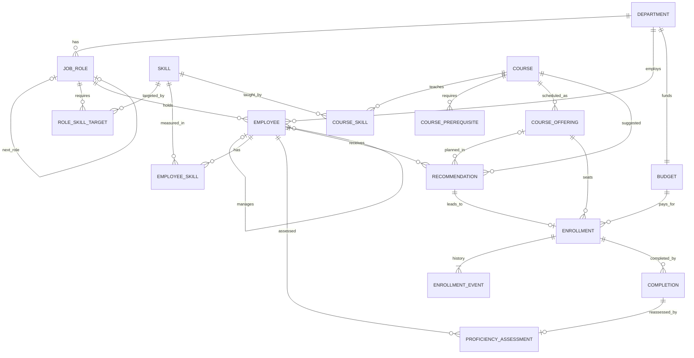

# Skill Gap to Learning Path: Architecture

This is the build plan for the whole project. It covers what we build, how the
parts connect, every table and rule, every edge case, how we check the data,
and the order we build it in.

If code and this file disagree, one of them is wrong. Fix it, don't work around it.

Revision 4. Section 16 lists the changes from the first review, section 17 the changes made while building, and section 18 the changes from the second review.

---

## 0. Decisions already made

| Topic | Decision |
|---|---|
| Stack | Python 3.12, pandas, numpy, FastAPI, psycopg2 (raw SQL, no ORM), PostgreSQL, pytest. React 19 + Vite + Bootstrap 5 + axios + react-router-dom, written in the same style as the Scholarship RAG Project frontend |
| Data | Fully synthetic. No external datasets. Names come from small word lists we write ourselves |
| Planning period | 2026-01-01 to 2026-12-31 |
| Planning date | 2026-01-05. This is the date of the annual planning run. The plan uses only data dated on or before this day |
| As-of date (snapshot) | 2026-12-31. Nothing is dated after it |
| Proficiency | Whole numbers 0 to 5, derived from a 0 to 100 assessment score using fixed bands. `gap = max(0, target_level - current_level)` |
| Retakes | None. `(employee_id, course_id)` is unique in enrollment and in recommendation |
| History | Status changes go in `enrollment_event`. Proficiency changes go in `proficiency_assessment`. We only ever add rows |
| IDs | Assigned when the row is created, parents before children. Never renumbered (section 3.2) |
| Seed | `20261022` |
| Scales | `starter` = 10% of `full`. Same generator, same code path. Scale-dependent choices are computed, not hard-coded |
| Edge cases | 50 per type at full scale and 5 per type at starter, with labels in a separate ground truth file |
| Currency | INR, NUMERIC(12,2) |
| Repository | `C:\CandidateWorkspace`, git, generated data committed under `output/` |
| Auth | None. Actors are covered by pages, not logins (same as the reference project) |

---

## 1. The shape of the whole thing

There are three parts. They run at different times and Postgres is the only
thing they share.

```
 (1) PIPELINE  - offline, run by hand            python -m pipeline.run --scale full
 ----------------------------------------------------------------------------------
 config.py  (seed, scale, dates, knobs)  ->  config.check_scale()  fails early if the scale cannot work
     |
     v
 stages/s01..s05   master and catalog data          (parents first, IDs assigned at creation)
 stages/s06_plan   January planning run             (rules/recommend.py, planning-date data only)
 stages/s07_budgets  limits, then allocate them to proposed steps (the funded plan)
 stages/s08_simulate  2026 event simulation         (requests, decisions, starts, withdrawals,
                                                     completions with results, reassessments)
     |   = the valid baseline. With injection switched off it must pass every check.
     v
 stages/s09_inject    the 5 labelled edge-case types  --> ground truth (kept apart)
 stages/s10_finalize  assessment IDs, every derived column, skill_gap
     |
     v
 checks/validate.py   structure + business rules, record-level match to ground truth
 checks/detect.py     finds anomalies WITHOUT reading ground truth
 checks/evaluate.py   business metrics + detector precision/recall per record
     |
     v
 export.py  -->  output/<scale>/  csv/  json/  sql/  ground_truth/  reports/  manifest.json


 (2) LOADER  - run once per dataset              python -m scripts.load_data --scale full
 ----------------------------------------------------------------------------------
 output/<scale>/csv  --COPY-->  Postgres schema "public"   (input data)
 ground_truth + reports       -->  Postgres schema "eval"  (evaluation only)


 (3) APP  - online
 ----------------------------------------------------------------------------------
 browser -> frontend/src/api.js -> backend/app/main.py (FastAPI, read only)
                                          |
                                   app/queries.py (raw SQL) -> Postgres
                                   pipeline/rules/recommend.py  (live preview with an explicit
                                                                 planning date and period:
                                                                 the same code as the January run)
```

Two design points matter most:

1. **`pipeline/rules/` holds every business rule as a pure function.** Rules
   take data and a date and return decisions. They never generate random
   numbers. The generator, the validator, the detector and the API all import
   them, so each rule exists in exactly one place.
2. **Randomness lives only in `pipeline/stages/`.** Random choices include hire
   dates, test scores, and whether someone requests or withdraws. Rules turn
   those choices into outcomes, so labels and statuses always come from
   documented rules.

---

## 2. Actors and what each one uses

| Actor | What they need | Where it lives |
|---|---|---|
| Employee / candidate | My skills, my gaps, my learning path, my enrollments and results | Employee detail page |
| Manager | My team's gaps and paths, decisions and reasons, a fresh path preview | Employees page filtered by `manager_id`, then Employee detail |
| HR partner | Budgets per department (planned vs limit vs committed), rejections, exceptions | Budgets page, Exceptions page |
| IT / operations partner | Load the data, check the data is valid | `scripts/load_data.py`, Evaluation page |
| System administrator | Run the generator, check reproducibility | `pipeline.run`, `scripts/check_reproducibility.py`, README |

In the data, actors show up as `enrollment_event.actor`
(EMPLOYEE, MANAGER, HR_PARTNER, SYSTEM) and `proficiency_assessment.assessor_type`.

---

## 3. Data model

### 3.1 Tables

16 input tables, 1 derived table and 4 evaluation tables.

| # | Table | Kind | Comes from |
|---|---|---|---|
| 1 | `department` | supporting master | fixed list of 8 |
| 2 | `job_role` | core master (Role) | 5 per department = 40 |
| 3 | `skill` | core master | s01 |
| 4 | `role_skill_target` | core bridge (N:M) | s01, ladder rule |
| 5 | `employee` | core master | s02 |
| 6 | `proficiency_assessment` | supporting event history | s03 (BASELINE), s08 (POST_COURSE) |
| 7 | `employee_skill` | core bridge (N:M) | s03 + derived current state |
| 8 | `course` | core master | s04 |
| 9 | `course_skill` | core bridge (N:M) | s04 |
| 10 | `course_prerequisite` | core bridge (Prerequisite) | s04, DAG rule |
| 11 | `course_offering` | supporting (availability, capacity) | s05 |
| 12 | `budget` | core | s07 limit, derived totals |
| 13 | `recommendation` | supporting | s06 planning run |
| 14 | `enrollment` | core transaction | s08 |
| 15 | `enrollment_event` | supporting event history | s08 |
| 16 | `completion` | core event | s08 |
| 17 | `skill_gap` | **derived** | s10 |
| - | `eval.ground_truth`, `eval.detected_issue`, `eval.validation_result`, `eval.metric` | evaluation only | checks/ |

`Role` is named `job_role` in SQL because `role` is a keyword in Postgres.

### 3.2 IDs

**Rule:** an ID is assigned when its row is created, and it never changes.
Parent stages run before child stages, so a child always points at an ID that
already exists. Nothing is renumbered at the end, so no ordering that a decision
used can ever shift afterwards.

| Entity | Format | Assigned in | Number order |
|---|---|---|---|
| Department | 3-letter code (`ENG`) | s01 | fixed list |
| Role | `ROL-000001` | s01 | department order, then career level |
| Skill | `SKL-000001` | s01 | category order, then name |
| Employee | `EMP-000001` | s02 | department, then hire_date, then name (sorted before numbering) |
| Course | `CRS-000001` | s04 | category, level, title |
| Offering | `OFF-000001` | s05 | course_id, start_date |
| Budget | `BUD-<department>-2026` | s07 | one per department |
| Recommendation | `REC-<employee-id>-<course-id>` | s06 | the pair itself (no counter) |
| Enrollment | `ENR-<employee-id>-<course-id>` | s08 | the pair itself (no counter) |
| Event | `EVT-000001` | s08 | the order the simulation writes events (date order, see 5.3) |
| Completion | `CMP-2026-000001` | s08 | the order the simulation writes completions (date order) |
| Assessment | `ASM-000001` | s10 | assessed_on, employee_id, skill_id |
| Ground truth case | `GT-000001` | s09 | issue_type, record_id |

Why the assessment ID is the one exception: assessments are leaves. Nothing
references them except `employee_skill.last_assessment_id`, which is derived in
s10 anyway. Numbering them once after injection means a missing reassessment
(an edge case) leaves no hole in the sequence.

Known trade-off: the injector creates new events and completions after the
simulation, so they take the next free `EVT` and `CMP` numbers. An ID is not an
input feature, the detector never looks at ID order, and the README states this.
Recommendation and enrollment IDs are pair-based, so injected rows there look
exactly like normal rows.

### 3.3 Departments, categories and scale-aware skill selection

| Code | Department | Home skill category |
|---|---|---|
| ENG | Engineering | Software Engineering |
| DAT | Data & Analytics | Data & AI |
| ITS | IT Services | Infrastructure & Cloud |
| SAL | Sales | Sales |
| MKT | Marketing | Marketing |
| FIN | Finance | Finance |
| HRM | Human Resources | People & HR |
| OPS | Operations | Operations & Supply Chain |

Every department also shares two categories: **Leadership & Communication** and
**Digital Productivity**. That makes 10 categories, with
`skills_per_category = skills / 10` (full: 50, starter: 5).

Each department gets one **ladder list** of 10 skills. How many come from the
home category depends on the scale:

```
home_count   = min(6, skills_per_category)      full: 6   starter: 5
shared_count = 10 - home_count                  full: 4   starter: 5
```

The home skills come first, then the shared ones. Shared skills are drawn from
the 2 x skills_per_category shared skills (full: 100, starter: 10).
`config.check_scale()` stops the run before any data is made unless:
- `home_count >= 4`, because the first 4 ladder skills are CORE,
- `shared_count <= 2 x skills_per_category`,
- every edge-case count fits its candidate pool (counted again in s09).

### 3.4 Score bands (used by every assessment)

| Level | 0 | 1 | 2 | 3 | 4 | 5 |
|---|---|---|---|---|---|---|
| assessment_score | 0-19 | 20-39 | 40-54 | 55-69 | 70-84 | 85-100 |

`proficiency_level = band(assessment_score)` always holds (BR-15).

### 3.5 Data dictionary

`DATE` is ISO `YYYY-MM-DD`. Money is `NUMERIC(12,2)` INR. "Derived" means s10
recomputes the value from other rows and the validator checks it again.

**department**
| Field | Type | Req | Allowed / rule |
|---|---|---|---|
| department_code | CHAR(3) PK | yes | one of the 8 codes |
| department_name | VARCHAR(60) | yes | unique |
| home_category | VARCHAR(40) | yes | one of the 10 categories |

**job_role**
| Field | Type | Req | Allowed / rule |
|---|---|---|---|
| role_id | VARCHAR(10) PK | yes | `^ROL-\d{6}$` |
| role_title | VARCHAR(80) | yes | unique |
| department_code | FK department | yes | |
| career_level | SMALLINT | yes | 1 to 5 |
| next_role_id | FK job_role | no | null only when career_level = 5. Otherwise same department, career_level + 1 |

**skill**
| Field | Type | Req | Allowed / rule |
|---|---|---|---|
| skill_id | VARCHAR(10) PK | yes | `^SKL-\d{6}$` |
| skill_name | VARCHAR(80) | yes | unique |
| skill_category | VARCHAR(40) | yes | one of the 10 categories |

**role_skill_target** (PK = role_id + skill_id)
| Field | Type | Req | Allowed / rule |
|---|---|---|---|
| role_id | FK job_role | yes | |
| skill_id | FK skill | yes | a level-L role has exactly 5+L rows: the first 5+L skills of its department's ladder list |
| target_level | SMALLINT | yes | 1 to 5. `min(5, base_level(skill) + (L-1)//2)`, base_level in {1,2,3}, so targets never go down up the ladder |
| importance | VARCHAR(10) | yes | CORE (ladder positions 1 to 4), SUPPORTING (the rest) |
| effective_from | DATE | yes | 2026-01-01 |
| effective_to | DATE | no | null = in force. If set, it must be after effective_from |

**employee**
| Field | Type | Req | Allowed / rule |
|---|---|---|---|
| employee_id | VARCHAR(10) PK | yes | `^EMP-\d{6}$` |
| first_name, last_name | VARCHAR(40) | yes | from our own word lists |
| department_code | FK department | yes | equals the department of role_id |
| role_id | FK job_role | yes | current role |
| target_role_id | FK job_role | yes | role_id (development) or the role's next_role_id (career pathway) |
| manager_id | FK employee | no | same department, higher career_level, never self. Null only at career level 5 |
| hire_date | DATE | yes | 2010-01-01 to 2025-09-30 |
| employment_status | VARCHAR(10) | yes | ACTIVE, ON_LEAVE |

**proficiency_assessment** (append-only history)
| Field | Type | Req | Allowed / rule |
|---|---|---|---|
| assessment_id | VARCHAR(10) PK | yes | `^ASM-\d{6}$` |
| employee_id | FK employee | yes | |
| skill_id | FK skill | yes | |
| assessment_type | VARCHAR(12) | yes | BASELINE, POST_COURSE |
| assessed_on | DATE | yes | BASELINE: 2025-10-01 to 2025-12-31. POST_COURSE: completed_on + 3 to 14 days, no later than the as-of date |
| assessment_score | SMALLINT | yes | 0 to 100. The evidence |
| proficiency_level | SMALLINT | yes | `band(assessment_score)` (BR-15) |
| assessor_type | VARCHAR(12) | yes | BASELINE: MANAGER or SKILL_TEST. POST_COURSE: SKILL_TEST |
| completion_id | FK completion | no | required if and only if POST_COURSE. The completion's recommendation is CLOSES_GAP and skill_id = its target_skill_id |

**employee_skill** (PK = employee_id + skill_id)
| Field | Type | Req | Allowed / rule |
|---|---|---|---|
| employee_id | FK employee | yes | |
| skill_id | FK skill | yes | one row for every skill of the current role and the target role |
| baseline_level | SMALLINT | yes | the BASELINE assessment level |
| current_level | SMALLINT | yes | derived: latest assessment on or before the as-of date |
| last_assessment_id | FK proficiency_assessment | yes | derived |
| last_assessed_on | DATE | yes | derived |

**course**
| Field | Type | Req | Allowed / rule |
|---|---|---|---|
| course_id | VARCHAR(10) PK | yes | `^CRS-\d{6}$` |
| course_title | VARCHAR(120) | yes | unique |
| skill_category | VARCHAR(40) | yes | category of its PRIMARY skill |
| course_level | VARCHAR(12) | yes | FOUNDATION, INTERMEDIATE, ADVANCED |
| delivery_mode | VARCHAR(10) | yes | ONLINE, BLENDED, CLASSROOM |
| duration_hours | SMALLINT | yes | a multiple of 4. FOUNDATION 4-12, INTERMEDIATE 8-24, ADVANCED 16-40 |
| cost_amount | NUMERIC(12,2) | yes | derived: duration_hours x rate (ONLINE 600, BLENDED 1,000, CLASSROOM 1,500) |
| currency | CHAR(3) | yes | INR |
| course_status | VARCHAR(10) | yes | ACTIVE, RETIRED |

**course_skill** (PK = course_id + skill_id)
| Field | Type | Req | Allowed / rule |
|---|---|---|---|
| course_id | FK course | yes | |
| skill_id | FK skill | yes | |
| skill_role | VARCHAR(10) | yes | PRIMARY, SECONDARY. Exactly one PRIMARY per course |
| target_level | SMALLINT | yes | the level the course can certify. PRIMARY: FOUNDATION 2, INTERMEDIATE 3 or 4, ADVANCED 5. SECONDARY: PRIMARY target - 1, minimum 1 |

**course_prerequisite** (PK = course_id + prerequisite_course_id)
| Field | Type | Req | Allowed / rule |
|---|---|---|---|
| course_id | FK course | yes | |
| prerequisite_course_id | FK course | yes | different course, same skill_category, strictly lower course_level. This makes cycles impossible. The longest chain is ADVANCED to INTERMEDIATE to FOUNDATION |

**course_offering**
| Field | Type | Req | Allowed / rule |
|---|---|---|---|
| offering_id | VARCHAR(10) PK | yes | `^OFF-\d{6}$` |
| course_id | FK course | yes | |
| start_date | DATE | yes | a Monday |
| end_date | DATE | yes | derived: start_date + (duration_hours / 4) x 7 - 1. Courses run at 4 hours a week |
| capacity | SMALLINT | yes | ONLINE 100, BLENDED 40, CLASSROOM 25 |
| seats_planned | SMALLINT | yes | derived: RECOMMENDED rows with this planned_offering_id. No more than capacity |
| seats_approved | SMALLINT | yes | derived: enrollments that ever reached APPROVED. No more than capacity |

**budget**
| Field | Type | Req | Allowed / rule |
|---|---|---|---|
| budget_id | VARCHAR(16) PK | yes | `^BUD-[A-Z]{3}-2026$` |
| department_code | FK department | yes | unique per fiscal_year |
| fiscal_year | SMALLINT | yes | 2026 |
| limit_amount | NUMERIC(12,2) | yes | policy: `FUNDING_RATIO` (0.85) x the department's proposed demand in the January plan, rounded up to 10,000 |
| planned_amount | NUMERIC(12,2) | yes | derived: sum of estimated_cost of RECOMMENDED (proposed) rows in the department |
| funded_amount | NUMERIC(12,2) | yes | derived: sum of estimated_cost of FUNDED rows. Never above the limit |
| committed_amount | NUMERIC(12,2) | yes | derived: sum of cost_amount of enrollments that reached APPROVED |
| remaining_amount | NUMERIC(12,2) | yes | derived: limit - committed. Can be negative |
| utilization_pct | NUMERIC(6,2) | yes | derived: committed / limit x 100 |
| budget_status | VARCHAR(12) | yes | derived: EXCEEDED when funded_amount + approvals outside the funded plan > limit, otherwise WITHIN_LIMIT |
| currency | CHAR(3) | yes | INR |

**recommendation**
| Field | Type | Req | Allowed / rule |
|---|---|---|---|
| recommendation_id | VARCHAR(30) PK | yes | `^REC-EMP-\d{6}-CRS-\d{6}$`, matching employee_id and course_id |
| employee_id | FK employee | yes | |
| course_id | FK course | yes | |
| target_skill_id | FK skill | yes | the gap skill this course serves |
| required_for_course_id | FK course | no | set only when reason_code = PREREQUISITE_FOR |
| decision | VARCHAR(16) | yes | RECOMMENDED, NOT_RECOMMENDED |
| reason_code | VARCHAR(30) | yes | RECOMMENDED: CLOSES_GAP, PREREQUISITE_FOR. NOT_RECOMMENDED: COURSE_UNAVAILABLE, PREREQUISITE_UNAVAILABLE, PATH_LIMIT, OVER_BUDGET, NO_SCHEDULE |
| path_sequence | SMALLINT | no | 1 to 4, no gaps per employee, when RECOMMENDED. Null otherwise |
| planned_offering_id | FK course_offering | no | required when RECOMMENDED, null otherwise. Same course |
| planned_start_date, planned_end_date | DATE | no | derived from planned_offering_id |
| estimated_cost | NUMERIC(12,2) | yes | derived: course.cost_amount |
| cumulative_cost | NUMERIC(12,2) | no | derived: running sum of estimated_cost over path_sequence 1..n. No more than the learning allowance |
| funding_status | VARCHAR(24) | no | FUNDED, NOT_FUNDED_BUDGET, NOT_FUNDED_PREREQUISITE on RECOMMENDED rows (BR-21), null on NOT_RECOMMENDED |
| planning_date | DATE | yes | 2026-01-05 |
| period_start, period_end | DATE | yes | 2026-01-01, 2026-12-31 |

**enrollment**
| Field | Type | Req | Allowed / rule |
|---|---|---|---|
| enrollment_id | VARCHAR(30) PK | yes | `^ENR-EMP-\d{6}-CRS-\d{6}$`, matching employee_id and course_id |
| employee_id | FK employee | yes | |
| course_id | FK course | yes | |
| offering_id | FK course_offering | yes | equals the recommendation's planned_offering_id |
| recommendation_id | FK recommendation | yes | same pair, decision RECOMMENDED |
| budget_id | FK budget | yes | budget of the employee's department |
| requested_on | DATE | yes | inside the planning period, at least 7 days before the offering's start_date |
| cost_amount | NUMERIC(12,2) | yes | derived: course.cost_amount |
| current_status | VARCHAR(12) | yes | derived: to_status of the last event |
| last_event_on | DATE | yes | derived |

**enrollment_event** (append-only history)
| Field | Type | Req | Allowed / rule |
|---|---|---|---|
| event_id | VARCHAR(10) PK | yes | `^EVT-\d{6}$` |
| enrollment_id | FK enrollment | yes | |
| event_seq | SMALLINT | yes | 1, 2, 3 ... with no gaps per enrollment |
| from_status | VARCHAR(12) | no | null only when event_seq = 1 |
| to_status | VARCHAR(12) | yes | REQUESTED, APPROVED, REJECTED, IN_PROGRESS, COMPLETED, WITHDRAWN |
| event_on | DATE | yes | does not go down as event_seq goes up. Within the planning period and no later than the as-of date |
| actor | VARCHAR(12) | yes | EMPLOYEE, MANAGER, HR_PARTNER, SYSTEM |
| reason_code | VARCHAR(20) | no | REJECTED: NO_SEATS, BUDGET_EXHAUSTED. WITHDRAWN: PERSONAL, WORKLOAD |

**completion**
| Field | Type | Req | Allowed / rule |
|---|---|---|---|
| completion_id | VARCHAR(16) PK | yes | `^CMP-2026-\d{6}$` |
| enrollment_id | FK enrollment | yes | **no UNIQUE constraint in the database.** A duplicate is a labelled anomaly, so the database must accept it and the validator must catch it |
| completed_on | DATE | yes | equals the offering's end_date, no later than the as-of date |
| attendance_pct | NUMERIC(5,1) | yes | 0 to 100 |
| final_score | SMALLINT | yes | 0 to 100 (end-of-course exam) |
| result | VARCHAR(8) | yes | derived: PASSED if attendance_pct >= 75 and final_score >= 60, otherwise FAILED |

**skill_gap** (derived, PK = employee_id + skill_id)
| Field | Type | Rule |
|---|---|---|
| employee_id, skill_id | FK | one row per skill of the employee's target role |
| target_role_id | FK | employee.target_role_id |
| target_level | SMALLINT | from role_skill_target |
| planning_level | SMALLINT | latest assessment on or before the planning date |
| planning_gap | SMALLINT | max(0, target - planning_level) |
| current_level, current_gap | SMALLINT | from employee_skill. max(0, target - current) |
| plan_status | VARCHAR(26) | see 5.2 step 4 |
| gap_status | VARCHAR(10) | NO_GAP (planning_gap = 0), CLOSED (planning_gap > 0 and current_gap = 0), OPEN (current_gap > 0) |

### 3.6 Relationships and cardinality

| Parent | Child | Cardinality | Optional? |
|---|---|---|---|
| department | job_role, employee | 1:N each | no |
| department | budget | 1:N (1 per year, so 1:1 in 2026) | no |
| job_role | job_role (next_role_id) | 1:1 ladder | yes (top level has none) |
| job_role and skill | role_skill_target | N:M through the bridge | |
| job_role | employee (role_id, target_role_id) | 1:N each | no |
| employee | employee (manager_id) | 1:N | yes |
| employee and skill | employee_skill | N:M through the bridge | |
| employee and skill | proficiency_assessment | 1:N history | |
| course and skill | course_skill | N:M through the bridge | |
| course and course | course_prerequisite | N:M self bridge | yes |
| course | course_offering | 1:N | yes (RETIRED courses have none) |
| employee and course | recommendation | at most 1 per pair | |
| course_offering | recommendation (planned) | 1:N | yes |
| recommendation | enrollment | 1:0..1 | yes |
| course_offering | enrollment | 1:N | |
| budget | enrollment | 1:N | |
| enrollment | enrollment_event | 1:N (at least 1) | no |
| enrollment | completion | 1:0..1 by rule (a 2nd row is the anomaly) | yes |
| completion | proficiency_assessment (POST_COURSE) | 1:0..1 | yes |



### 3.7 Lifecycle states

Enrollment (taken from `enrollment_event`):

```
REQUESTED --> APPROVED --> IN_PROGRESS --> COMPLETED
    |             |              |
    v             v              v
 REJECTED     WITHDRAWN      WITHDRAWN
```

These are the only allowed transitions: `REQUESTED->APPROVED`,
`REQUESTED->REJECTED`, `APPROVED->IN_PROGRESS`, `APPROVED->WITHDRAWN`,
`IN_PROGRESS->COMPLETED`, `IN_PROGRESS->WITHDRAWN`. The terminal states are
REJECTED, COMPLETED and WITHDRAWN. At the as-of date an enrollment can still be
APPROVED or IN_PROGRESS.

| Transition | Actor |
|---|---|
| to REQUESTED | EMPLOYEE |
| to APPROVED | MANAGER |
| to REJECTED with NO_SEATS | SYSTEM |
| to REJECTED with BUDGET_EXHAUSTED | HR_PARTNER |
| to IN_PROGRESS, to COMPLETED | SYSTEM |
| to WITHDRAWN | EMPLOYEE |

Other lifecycles:
- **Recommendation:** decided once in the planning run and never changed.
  Whether it was acted on is shown by joining to enrollment.
- **Skill:** BASELINE assessment, then course, completion and POST_COURSE
  assessment. The current level always comes from the latest assessment.
- **Course:** ACTIVE or RETIRED. Available only under BR-04.
- **Budget:** WITHIN_LIMIT or EXCEEDED, derived from approvals.

---

## 4. Business rules

Every rule has a code. The validator, the detector and the ground truth all
refer to these codes.

**Planning (recommendation) rules.** These are checked by `rules/recommend.py`
for a given planning date and period.

| Code | Rule |
|---|---|
| BR-01 | Gap is against the **target role**: `gap = max(0, target_level - level)`, where level is the latest assessment on or before the planning date. |
| BR-02 | Only ACTIVE employees get recommendations. ON_LEAVE gaps get `plan_status = EMPLOYEE_ON_LEAVE`. |
| BR-03 | A course *covers* a gap when it is ACTIVE and `course_skill.target_level >= target_level` for that skill. |
| BR-04 | A course is *available* when it is ACTIVE and has at least one offering whose start_date is inside the planning period. |
| BR-05 | Prerequisites: every prerequisite of a course must be PASSED by the employee with `completed_on` before the course's start_date, **or** be planned earlier in the same path with its planned end at least 14 days before this course's planned start. The same rule applies at enrollment: an in-path prerequisite must be PASSED before the offering starts. |
| BR-06 | Candidate order for a gap: available first, then lowest cost, then shortest duration, then lowest course_id. A course that already has a recommendation row for this employee is skipped (it cannot get a second row). |
| BR-07 | Path size: at most 4 RECOMMENDED courses. A course is added only together with its whole prerequisite chain. If a chain does not fit, **the next candidate is tried**. |
| BR-08 | Schedule and seats: the path runs one course at a time. Step 1 starts at least 14 days after the planning date. Each next step starts at least 14 days after the previous step's end. Every planned start is inside the planning period. Each step uses the earliest offering that meets these limits **and still has a free seat** (`capacity - approved as of planning date - seats already planned in this run > 0`). The plan books that seat. |
| BR-09 | Planning budget, always on the **total**: what is already on the path + every new prerequisite + the candidate. (a) That total plus what the employee already spent this period is within the 60,000 allowance. (b) That total is within the department money still free on the planning date: limit - committed - money allocated to other people's open funded steps. |
| BR-20 | Point-in-time rule: the plan only uses assessments, completions, enrollments, seats and budget dated on or before the planning date, and only offerings that start inside the planning period. The period must be inside the budget year (2026), because there is no budget for any other year. |
| BR-21 | Funding: each department's limit is shared out over its proposed steps, everyone's first step before anyone's second (within a round: earliest planned start, then employee_id). A step is FUNDED if it fits what is left, NOT_FUNDED_PREREQUISITE if a prerequisite step in its path was not funded, otherwise NOT_FUNDED_BUDGET. |

**Operational rules.** These are applied in the simulation and checked by the validator.

| Code | Rule |
|---|---|
| BR-10 | Seats at approval: approve only if `seats_approved < capacity`. A seat is taken on approval and not given back. Checked before budget. |
| BR-11 | Budget at approval: approve only a **FUNDED** step (BR-21), and only if `committed + cost <= limit` (a second guard; funded steps never add up to more than the limit). A request for an unfunded step is REJECTED with BUDGET_EXHAUSTED by HR. Money is committed on approval and not refunded. |
| BR-12 | Lifecycle: only the transitions in 3.7. The first event is REQUESTED. |
| BR-13 | One completion per enrollment, only for enrollments that reached COMPLETED, with `completed_on = offering.end_date`. |
| BR-14 | `result = PASSED` if and only if `attendance_pct >= 75` and `final_score >= 60`. |
| BR-15 | Every assessment: `proficiency_level = band(assessment_score)` (3.4). |
| BR-16 | A POST_COURSE score can never be higher than the top of the band for the course's target_level for that skill. A course cannot certify above what it teaches. |
| BR-17 | Every completion of a **CLOSES_GAP** recommendation gets a POST_COURSE assessment of its target skill 3 to 14 days after completed_on. This is only checked when `completed_on <= as_of - 14 days`, because later ones are not due yet. Prerequisite courses are not reassessed: their pass/fail result is the evidence that gates the next course. |
| BR-18 | No retakes: `(employee_id, course_id)` is unique in recommendation and enrollment. |
| BR-19 | History is append-only. Status and proficiency are derived from the latest event, never overwritten. |

**Proposed and funded.** The January data holds two plans, kept apart on purpose:

1. The **proposed plan** is every RECOMMENDED row. The engine makes it before any
   budget exists, and checks dates, seats, prerequisites, path size and the
   employee's allowance. Plans book seats, because a seat belongs to one class on
   one date.
2. Each department's **limit** is then set to 85% of its proposed demand
   (`FUNDING_RATIO`). A department funds less than its people propose, on purpose.
3. The limit is **allocated** to proposed steps (BR-21). That gives the **funded
   plan**: the FUNDED rows, which never cost more than the limit.
4. At approval, only funded steps go through (BR-11). Some employees ask for an
   unfunded step anyway, and HR rejects it. That is the normal budget exception
   path, and it is visible in the data.

Setting the limit from the proposals cannot change the proposals. In January
nothing is committed or allocated, so BR-09(b) only asks whether one employee's
whole path costs more than the department's whole budget. A path never costs more
than the 60,000 allowance, and s07 stops the run if any limit is below that.
The Budgets page shows proposed, limit, funded and committed side by side.

---

## 5. How the generator works

All randomness comes from `numpy.random.default_rng([SEED, stage_number])`.
Each stage has its own random stream, so changing one stage never changes
another stage's numbers.

### 5.1 Stages

| Stage | File | Writes | What it does |
|---|---|---|---|
| s01 | `s01_reference.py` | department, job_role, skill, role_skill_target | 8 departments. 5 ladder roles each, linked by next_role_id. Skills from word lists. Ladder list per 3.3. Targets per the job_role / role_skill_target rules |
| s02 | `s02_employees.py` | employee | Department sizes ENG 22%, OPS 16%, SAL 14%, DAT 12%, ITS 11%, FIN 9%, MKT 9%, HRM 7%. Career levels 35/30/20/10/5%. 5% ON_LEAVE. 25% of ACTIVE employees below level 5 target the next role. IDs assigned, then managers picked (same department, higher level) |
| s03 | `s03_proficiency.py` | proficiency_assessment (BASELINE), employee_skill | For each current-role skill: `level = max(0, target - d)` with d = 0/1/2/3 at 45/30/17/8%. Skills only in the target role start at 0 to 2. The score is drawn uniformly inside that level's band, so BR-15 holds. Dated Q4 2025. Assessment IDs are given in s10 |
| s04 | `s04_catalog.py` | course, course_skill, course_prerequisite | 2 PRIMARY courses per skill: the first FOUNDATION or INTERMEDIATE (50/50), the second INTERMEDIATE or ADVANCED (40/60). 0 to 2 SECONDARY skills from the same category. Mode ONLINE 50%, BLENDED 30%, CLASSROOM 20%. 4% RETIRED. 60% of INTERMEDIATE courses get 1 FOUNDATION prerequisite. Every ADVANCED course gets 1 INTERMEDIATE prerequisite, plus a FOUNDATION one 30% of the time |
| s05 | `s05_offerings.py` | course_offering | ACTIVE courses: 4 to 7 offerings with Monday starts between 12 Jan and 21 Dec 2026. 10% of ACTIVE courses get 1 to 2 offerings in 2027 only, so they are unavailable in the period. RETIRED courses: none |
| s06 | `s06_plan.py` | recommendation | The January planning run: `rules/recommend.py` for every ACTIVE employee in employee_id order, planning_date 2026-01-05, sharing one seat ledger (5.2) |
| s07 | `s07_budgets.py` | budget, recommendation.funding_status | Limit = `FUNDING_RATIO` (0.85) x proposed demand, rounded up to 10,000. Then the funded plan: the limit is allocated to proposed steps (BR-21). s07 stops the run if any limit is below one employee's allowance, which proves BR-09(b) could not have changed a January proposal |
| s08 | `s08_simulate.py` | enrollment, enrollment_event, completion, proficiency_assessment (POST_COURSE) | One discrete-event simulation of 2026 that also produces results and reassessments, so every later decision can see earlier pass/fail results (5.3) |
| s09 | `s09_inject.py` | extra rows, ground truth | The 5 edge-case types (section 6) |
| s10 | `s10_finalize.py` | assessment IDs, every derived column, skill_gap | Assessment IDs (3.2). Then cost, end_date, seats, budget totals, cumulative cost, current_status, current_level and gaps, all recomputed from the final rows |

### 5.2 Recommendation engine (`rules/recommend.py`)

This is a pure function. It runs in s06 and behind `POST /api/recommendations/preview`.

```
recommend(employee_id, planning_date, period_start, period_end, data, seat_ledger, settings)
  -> RECOMMENDED rows (the path), NOT_RECOMMENDED rows, plan_status per gap

0. Snapshot (BR-20): keep only assessments, completions, enrollments and budget
   approvals dated <= planning_date, and offerings starting inside the period.
   level(skill)  = latest assessment <= planning_date
   passed        = courses PASSED <= planning_date
   blocked       = courses with any enrollment row (BR-18), skipped as candidates
   slot_start    = planning_date + 14, or (the end of any APPROVED/IN_PROGRESS
                   course) + 14 if that is later
   spent         = cost of this period's approved enrollments of the employee
   dept_remaining = limit - committed as of planning_date

1. gaps = target-role skills with gap > 0                                   (BR-01)
   order: CORE first, bigger gap first, then skill_id

2. for each gap:
   a. a course already in the path covers it (BR-03) -> PLANNED, next gap
   b. candidates = covering courses, ordered by BR-06, minus blocked/already-rowed
      no candidates -> NO_COURSE, next gap
   c. for each candidate, in order (stop at the first that passes):
        chain = prerequisites not in passed and not in the path, found recursively,
                prerequisites before the course, ties by course_id
        check 1  availability of candidate and chain (BR-04)
                 -> COURSE_UNAVAILABLE / PREREQUISITE_UNAVAILABLE
        check 2  path size: len(path) + len(chain) + 1 <= 4 (BR-07)    -> PATH_LIMIT
        check 3  budget on the TOTAL: spent + path cost + chain cost + cost
                 <= allowance, and path cost + chain cost + cost
                 <= department free money (BR-09)                       -> OVER_BUDGET
        check 4  schedule: place chain then candidate one after another from
                 slot_start, earliest offering with a free seat, every gap
                 >= 14 days, start inside the period (BR-08). This also proves
                 that each prerequisite ends before its dependent starts (BR-05)
                                                                        -> NO_SCHEDULE
        all pass -> append the chain (PREREQUISITE_FOR) and the candidate
                    (CLOSES_GAP), book their seats in seat_ledger, move slot_start
                    -> PLANNED, next gap
        a check fails -> remember (candidate, reason), try the next candidate
   d. no candidate passed -> write ONE NOT_RECOMMENDED row for the best-ranked
      candidate with its reason; plan_status = that reason

3. path_sequence = 1..n in append order; cumulative_cost = running sum
```

Steps 2c and 2d are the fixes to "stop at the first failure": PATH_LIMIT,
OVER_BUDGET or NO_SCHEDULE on one candidate never ends the search. Another
candidate with a shorter chain, a lower cost or a better date can still win.

The point-in-time rule makes January honest. The s06 run sees only Q4 2025
assessments, no completions, empty seats and full budgets. A preview run
for 2026-07-01 sees July's levels, July's passed courses, July's seat counts and
July's remaining budget, and only offerings starting from 15 July.

**plan_status derivation in s10** (from final records, using the same functions):
EMPLOYEE_ON_LEAVE, then NO_GAP, then PLANNED if a RECOMMENDED course of the
employee covers the skill, then NO_COURSE if no ACTIVE course covers it,
otherwise the reason_code of the NOT_RECOMMENDED row of the highest-ranked
covering course (BR-06 order) that has one.

### 5.3 Event simulation (`s08_simulate.py`)

Everything that happens in 2026 runs in one priority queue ordered by
`(date, kind_rank, employee_id, path_sequence)`. The kind order on the same day
is COMPLETE, then WITHDRAW, then START, then DECIDE, then REQUEST. Each event
row gets its `EVT` number when it is written, and each completion row gets its
`CMP` number when it is written. So the numbers follow the processing order, and
the order used for budget decisions (event_on, event_id) is exactly the order
the simulation used.

1. **Plan:** each employee works through their RECOMMENDED path in
   path_sequence order, using the planned offering for each step.
2. **Request:** `requested_on = planned_start - U{7..21}` days. For step k > 1
   it must also be after the last terminal date of an earlier step. Then:
   - A FUNDED step is requested with probability 0.95. An unfunded step is
     still requested with probability 0.5 (the employee asks anyway), and is
     then rejected for budget. Otherwise the step is skipped.
   - It is skipped if an in-path prerequisite was not PASSED (BR-05). The result
     is already known, because the prerequisite ended at least 14 days before
     this step starts.
   - It is not requested if `requested_on` falls after 30 Nov (the simulation's
     request horizon).
3. **Decide:** `decided_on = requested_on + U{1..5}`. Check seats (BR-10), then
   funding (BR-11: only a FUNDED step is approved). Write APPROVED or REJECTED
   with a reason. Seats were booked
   by the plan, so NO_SEATS is expected to be rare or zero in the baseline. It
   stays a real check, and the live preview can still hit full classes.
4. **Withdraw:** an approved enrollment is withdrawn with probability 0.05 on a
   date in `[decided_on + 1, end_date - 1]`. If that date is before start_date,
   the transition is APPROVED->WITHDRAWN, otherwise IN_PROGRESS->WITHDRAWN.
5. **Start and complete:** IN_PROGRESS on start_date, COMPLETED on end_date.
   Events are only written if dated on or before the as-of date.
6. **Completion result** (written the moment the course completes):
   - `entry_level = max(0, primary target_level - 2)`
   - `pre_level` = current level in the course's PRIMARY skill (0 if never assessed)
   - `final_score = clip(round(Normal(mean, 12)), 0, 100)`, where
     `mean = clamp(70 + 6 x (pre_level - entry_level), 50, 85)`
   - `attendance_pct = round(100 x Beta(10, 1), 1)`
   - `result` by BR-14
7. **Reassessment** (CLOSES_GAP only, BR-17), on `completed_on + U{3..14}` if
   that is on or before the as-of date:
   - `pre_score` = the latest score for the target skill
   - `uplift = 0.8 x (final_score - 40)` if PASSED, `0.3 x max(0, final_score - 40)` if FAILED
   - `post_score = min(band_top(course target_level for that skill), clip(round(pre_score + uplift + Normal(0, 5)), 0, 100))` (BR-16)
   - `proficiency_level = band(post_score)` (BR-15)

   Example: pre level 2 (score 47), course target 4. Passing with 78 gives
   uplift 30, a post score of about 77, and level 4, so the gap closes.
   Passing with 62 gives a post score of about 65 and level 3, so the gap stays
   open. Attending, passing and closing the gap are three different results.
8. **Next step:** after a terminal state (REJECTED, WITHDRAWN, COMPLETED), the
   next path step's request is scheduled as in step 2.
9. **Stop:** no new requests are created once there are
   `enrollments - injected_enrollments` of them (full: 9,950, starter: 995).
   **If the year ends first, the run stops with an error saying how many are
   missing.** It never quietly writes a smaller dataset. Rejected requests are
   enrollment rows and count toward the total.

Calibration knobs, all in `config.py`: request probabilities (funded and unfunded),
withdrawal probability, offerings per course, `LEARNING_ALLOWANCE_PER_EMPLOYEE`, `FUNDING_RATIO`. They are
tuned once so the counts are reached and some budget rejections happen late in
the year. `reports/metrics.json` prints the real rates. The knobs are never
changed per run.

---

## 6. Edge cases (labelled, injected in s09)

Ground rules:
- Each injected case breaks **exactly one** rule. Candidates are filtered so
  everything else about the row stays valid.
- No row is used by more than one injector.
- All foreign keys stay valid, so Postgres loads the anomalies without errors.
- Labels go only to `ground_truth/`. No input table has a column that hints at them.
- Injected recommendations keep the path at 4 or fewer RECOMMENDED courses.
  They are added only for employees with 3 or fewer, at path_sequence n + 1.

| issue_type | Count (full / starter) | How it is injected | Only rule broken | Ground truth record |
|---|---|---|---|---|
| `PREREQUISITE_VIOLATION` | 50 / 5 | Add a RECOMMENDED `CLOSES_GAP` row for one of the employee's unplanned gap skills. The course is available and has a prerequisite that is neither PASSED nor in the path. It passes every other planning check: the path stays at 4 or fewer, the cost stays within the allowance, and the planned offering has a free seat and starts at least 14 days after the previous step ends, inside the period | BR-05 | recommendation_id |
| `COURSE_UNAVAILABLE` | 50 / 5 | Same as above, but the course is ACTIVE, has **no prerequisites**, and only has 2027 offerings. The planned offering is its earliest 2027 offering after the previous step + 14 days. It passes the size, budget and seat checks | BR-04 | recommendation_id |
| `BUDGET_EXCEEDED` | 50 / 5 | Take NOT_FUNDED_BUDGET steps that were never requested and approve them anyway (requested 7 to 21 days before the planned run, approved by a MANAGER). A step is only left unfunded when it costs more than what was still unallocated, so approving it always pushes the department's obligations (funded steps + approvals outside the funded plan) past its limit. The planned run is used, so the plan's booked seat covers it, and in-path prerequisites were PASSED. Funded approvals are judged on their own funding, not a running total, so the injected approval never changes how a normal row is judged. Departments are taken round-robin | BR-11 | enrollment_id |
| `DUPLICATE_COMPLETION` | 50 / 5 | For a COMPLETED enrollment, add a second completion row with a new CMP number and **exactly the same** completed_on, attendance, score and result. Only "one completion per enrollment" is broken | BR-13 | the second completion_id |
| `GAP_NOT_REASSESSED` | 50 / 5 | Pick a CLOSES_GAP completion where `completed_on <= as_of - 14`, the target skill still had a gap, and **no later completion of that employee touches the same skill** (so no later score was built on the removed one). Its POST_COURSE assessment is dropped before assessment IDs exist, so there is no hole in the numbering | BR-17 | completion_id |

The normal simulation makes 9,950 enrollments and the 50 budget cases bring the
file to exactly 10,000. s09 counts every candidate pool first, and stops with an
error if any pool is smaller than its target count.

`ground_truth.csv` columns:
`case_id, issue_type, entity, record_id, employee_id, related_ids, rule_code, expected_decision, description`

Example:
`GT-000051, BUDGET_EXCEEDED, enrollment, ENR-EMP-001204-CRS-000317, EMP-001204, BUD-ENG-2026;REC-EMP-001204-CRS-000317, BR-11, REJECTED:BUDGET_EXHAUSTED, "Approved 18,000 for a step the ENG budget did not fund; only 1,200 of the limit was unallocated."`

---

## 7. Validation, detection and evaluation

### 7.1 `checks/validate.py`

Each check returns `{check_id, rule_code, table, kind, failing_ids}`.
- `STRUCTURAL` checks must have no failing IDs.
- `RULE` checks are matched to ground truth **record by record**: the set of
  `(issue_type, record_id)` they fail must equal the ground truth set for that
  issue type. The report lists true positives, unexpected failures (false
  positives) and missed labels (false negatives) by ID. Matching counts is not
  enough.

| Category | Checks |
|---|---|
| Keys | unique and not null PKs. ID regexes. REC and ENR IDs match their employee_id and course_id |
| Foreign keys | every FK resolves. enrollment.offering_id = recommendation.planned_offering_id. offering course = enrollment course. Budget = the employee's department |
| Enums, required | from `pipeline/dictionary.py` |
| Dates | hire before baseline, baseline before 2026. requested_on <= start - 7. requested <= decided. event_on does not go down. start <= end. completed_on = end_date. reassessment 3 to 14 days after completion. 2026 events inside the period and on or before the as-of date. recommendation planning_date and period are the run's values |
| Arithmetic | cost = hours x rate. end_date formula. seats_planned and seats_approved counts, each no more than capacity. Budget planned, committed, remaining, utilization and status. cumulative_cost. current_status = last event. current_level = latest assessment. gaps. Employee department = role department. BR-14. BR-15 (band). BR-16 (cap) |
| Lifecycle | first event REQUESTED, allowed transitions only, event_seq without gaps |
| Graph | prerequisites have no cycles, same category, lower level. Ladder targets never go down. Manager hierarchy is valid. Each role has exactly 5+L targets |
| Path shape (STRUCTURAL) | at most 4 RECOMMENDED per employee, **including injected ones**. path_sequence 1..n without gaps. planned starts >= planning_date + 14, and each >= previous planned end + 14. cumulative_cost <= allowance. NOT_RECOMMENDED rows have no path fields |
| Engine reconciliation | re-run `rules/recommend.py` for the January planning date on the input data. Every RECOMMENDED and NOT_RECOMMENDED row it produces must exist unchanged. The **only** extra rows allowed in the table are the ground-truth PREREQUISITE_VIOLATION and COURSE_UNAVAILABLE IDs |
| RULE: BR-05 | RECOMMENDED rows whose prerequisites are neither PASSED nor planned early enough. Enrollments whose in-path prerequisite was not PASSED before start |
| RULE: BR-04 | RECOMMENDED rows for unavailable courses |
| RULE: BR-11 | approvals of steps that were not FUNDED, or that took committed spend past the limit |
| Funding (STRUCTURAL) | re-run the BR-21 allocation on the engine's proposed steps: it must give exactly the stored funding_status, and never allocate more than the limit. RECOMMENDED rows have a funding_status, NOT_RECOMMENDED rows do not |
| RULE: BR-13 | completions beyond the first per enrollment (lowest completion_id is the first) |
| RULE: BR-17 | due CLOSES_GAP completions (first per enrollment only) with no POST_COURSE assessment |
| Leakage | no input column looks like issue, anomaly, label or ground_truth. ground_truth/ is separate from csv/ |

**Pass condition:** every STRUCTURAL check has 0 failing IDs, and every RULE
check's failing set equals its ground truth set exactly.

### 7.2 `checks/detect.py`

The detector reads only input tables and never opens ground truth. It applies
the same five rule functions and writes `reports/detected_issues.csv` with
`issue_type, record_id, rule_code, evidence`.
- **BR-11:** walk approvals per department in (event_on, event_id) order and flag
  any approval of a step that was not FUNDED, or that took committed spend past
  the limit. Normal approvals are always of funded steps, so they are never flagged.
- **BR-17:** only the first completion of each enrollment is looked at, so a
  duplicate completion is never counted under a second issue type.

### 7.3 `checks/evaluate.py` → `reports/metrics.json` and `evaluation.md`

| Group | Metric |
|---|---|
| Detection | per issue_type and overall: TP, FP, FN, precision, recall and F1 on `(issue_type, record_id)`. Expected 1.0, and anything lower is a bug that the report names by ID |
| Gap coverage | share of gaps by plan_status. Share PLANNED |
| Gap closure by plan | for every RECOMMENDED path: does each CLOSES_GAP course cover its target (BR-03)? Must be 100% |
| Feasibility | share of proposed (RECOMMENDED) steps that pass **every** planning check: BR-04 availability, BR-05 prerequisites, BR-07 path size, BR-08 schedule spacing, period and seats, BR-09 allowance and department limit (`checks/feasibility.py`). Plus the count failing each rule. Engine rows 100%; the final data is lower by exactly the injected rows |
| Funding | share of proposed steps FUNDED, and share both feasible and funded. Reported separately, because a step can be feasible and still not funded |
| Budget | per department: limit, proposed, funded, committed, utilization, budget rejections |
| Funnel | recommended, requested, approved, started, completed, passed, reassessed, closed |
| Outcomes | closure rate of reassessed gaps, average score and level uplift, PASSED vs FAILED uplift |
| Outcome vs attendance | completion rate, pass rate and gap closure rate side by side |
| Distributions | gap sizes, cost and duration by level, enrollments per employee, utilization per offering |
| Duplicate impact | completion count raw vs distinct enrollments |

### 7.4 Reproducibility (`scripts/check_reproducibility.py`)

1. Generate a scale twice into `output/_repro/run_a` and `run_b` (gitignored).
2. Compare every file's row count and SHA-256.
3. Write `output/reproducibility/report_<scale>.json` and `.md`.

What makes runs byte-identical:
- Seeded per-stage random streams.
- IDs assigned at creation in a fixed order.
- Every table sorted by its PK at export.
- CSV with `lineterminator="\n"`, UTF-8 without BOM, and fixed decimal formatting.
- JSON with `sort_keys=True`, one record per line.
- No wall-clock time inside `output/<scale>/`.
- Sets are always sorted before they are iterated.
- `.gitattributes` sets `output/** -text`, so git never rewrites line endings.

---

## 8. Exports (`output/<scale>/`)

```
output/
  starter/                       same layout as full
  full/
    manifest.json                version, seed, scale, every parameter, planning date and period,
                                 as-of date, per-file row count + sha256, provenance = synthetic
    csv/<table>.csv              17 files (16 input + skill_gap)
    json/<table>.json            same 17, as arrays of records
    sql/schema.sql               DDL for the public and eval schemas
    sql/seed.sql                 INSERTs in load order, one transaction, batches of 1,000 rows
    ground_truth/ground_truth.csv
    ground_truth/ground_truth.json
    reports/validation_summary.json
    reports/validation_summary.md
    reports/detected_issues.csv
    reports/metrics.json
    reports/evaluation.md
  reproducibility/
    report_full.json  report_full.md  report_starter.json  report_starter.md
```

`pipeline/dictionary.py` is the single source for tables, columns, types,
required flags, enums and regexes. It builds `sql/schema.sql` and
`docs/data_dictionary.md`, and it drives the validator's enum, required and
format checks.

Postgres notes:
- All FKs are `DEFERRABLE INITIALLY DEFERRED`, and the loader uses one
  transaction. That handles the self-references and the completion/assessment
  link.
- Load order: department, job_role, skill, role_skill_target, employee, course,
  course_skill, course_prerequisite, course_offering, budget, recommendation,
  enrollment, enrollment_event, completion, proficiency_assessment,
  employee_skill, skill_gap, then eval.*.
- The loader uses `COPY`. `seed.sql` is the portable alternative.

---

## 9. Backend API (FastAPI, read only, raw SQL)

Same pattern as the reference project: `config.py` reads `.env` once, `db.py`
has a `_run()` that always closes the connection, and `main.py` holds the
routes under `/api`.

| Method | Path | Returns |
|---|---|---|
| GET | `/api/health` | `{status, database}` |
| GET | `/api/summary` | headline counts and rates |
| GET | `/api/employees?search=&department=&manager_id=&status=&limit=50&offset=0` | list with open-gap count |
| GET | `/api/employees/{employee_id}` | profile, roles, skill gaps, January path with decisions and reasons, enrollments with event timeline, completions next to assessments |
| POST | `/api/recommendations/preview` | body `{employee_id, planning_date, period_start, period_end}`. **All three dates are required.** The period must lie inside the 2026 budget year (otherwise 422), planning_date must be within the period, and period_end must be after period_start. The budget is picked by the period's fiscal year, never assumed. The result is a proposal; department free money = limit - committed - money held for other people's open funded steps. Runs `rules/recommend.py` on a point-in-time snapshot (BR-20) with a seat ledger built from the database. Returns the path with planned offerings and dates, rejected candidates with reasons, plan_status per gap, total cost vs allowance left vs department remaining. Nothing is saved |
| GET | `/api/courses?search=&category=&level=&available=` | list |
| GET | `/api/courses/{course_id}` | skills and levels, prerequisite chain (both ways), offerings with planned/approved/capacity |
| GET | `/api/budgets` | per department: limit, planned, committed, remaining, utilization, status |
| GET | `/api/exceptions?issue_type=&limit=&offset=` | detected issues, linked to their records |
| GET | `/api/evaluation` | validation summary, metrics, per-ID detection match, reproducibility |
| GET | `/api/departments`, `/api/skills/categories` | dropdown options |

Pydantic models go in `app/schemas.py`. Errors are
`HTTPException(404, "No employee with that id.")` or a 422 from Pydantic. The
frontend's `errorMessage.js` already handles both.

---

## 10. Frontend (same style as the Scholarship RAG Project)

Conventions taken from that project:
- Plain JavaScript JSX, one component per file, flat `src/`.
- Bootstrap 5, with Font Awesome 6.7.2 from the cdnjs CDN.
- `api.js` (one axios instance, `VITE_API_URL`, the "reply is HTML" guard) and
  `errorMessage.js`.
- `PageHeader.jsx`, plus `Layout.jsx` + `Navbar.jsx` with `NavLink` and `<Outlet />`.
- Pages use `useState` for `load`, `error` and data, an async function with
  try/catch/finally, and `{error && <div className="alert alert-danger">}`.
- Colours are CSS variables at the top of `App.css`, named by meaning.
- A short "why this exists" comment at the top of every component.
- oxlint. No state library, no TypeScript, no auth.

| Route | Page | Actor |
|---|---|---|
| `/` | `Home.jsx`: summary tiles and the workflow in 5 steps | everyone |
| `/employees` | `Employees.jsx`: search and filters | manager, HR |
| `/employees/:id` | `EmployeeDetail.jsx`: gaps, January path, enrollment timeline, outcomes. A **Preview path** form with planning date and period inputs (default: today's date inside 2026, period 2026-01-01 to 2026-12-31) | employee, manager |
| `/courses`, `/courses/:id` | `Courses.jsx`, `CourseDetail.jsx` | everyone |
| `/budgets` | `Budgets.jsx`: limit vs planned vs committed bars, EXCEEDED badge | HR partner |
| `/exceptions` | `Exceptions.jsx` | HR, IT/ops |
| `/evaluation` | `Evaluation.jsx`: validation table, per-ID detection match, metrics, reproducibility | IT/ops, admin |
| `*` | `NotFound.jsx` | |

Shared helpers: `StatusBadge.jsx`, `money.js` (INR, `en-IN` grouping, from the
reference project), `options.js` (enum labels).

---

## 11. Folder structure

```
C:\CandidateWorkspace\
├── README.md                     what it is, setup, commands, seed, outputs, results, known trade-offs
├── ARCHITECTURE.md               this file
├── .gitignore                    venv, node_modules, dist, .env, __pycache__, output/_repro/
├── .gitattributes                output/** -text
├── .env.example                  DB_NAME, DB_USER, DB_PASSWORD, DB_HOST, DB_PORT, DB_SSLMODE
│
├── docs/
│   ├── data_dictionary.md        generated from pipeline/dictionary.py
│   ├── business_rules.md         BR-01..BR-20 with worked examples
│   ├── edge_cases.md             the 5 injectors, their filters, expected decisions
│   └── provenance.md             fully synthetic, our own word lists, no personal data
│
├── backend/
│   ├── requirements.txt          fastapi, uvicorn, pydantic, psycopg2-binary, python-dotenv,
│   │                             pandas, numpy, pytest (versions pinned)
│   ├── pytest.ini
│   ├── pipeline/                 OFFLINE
│   │   ├── __init__.py
│   │   ├── config.py             SEED, SCALES, dates, rates, capacities, probabilities, allowance,
│   │   │                         FUNDING_RATIO, edge-case counts, check_scale()
│   │   ├── dictionary.py         tables, columns, types, enums, regexes (single source)
│   │   ├── ids.py                ID formatters + counters
│   │   ├── rng.py                stage_rng(stage_number)
│   │   ├── vocab.py              names, skill words, course title words
│   │   ├── rules/                PURE, no randomness, shared with the API
│   │   │   ├── snapshot.py       BR-20 point-in-time view of the data
│   │   │   ├── gaps.py           BR-01
│   │   │   ├── availability.py   BR-04
│   │   │   ├── prerequisites.py  chain expansion, BR-05
│   │   │   ├── schedule.py       BR-08 offering placement + seat ledger
│   │   │   ├── budget.py         BR-09 total-cost checks, BR-21 allocation, BR-11 approval
│   │   │   ├── recommend.py      BR-02, 03, 06, 07 + calls the above (5.2)
│   │   │   ├── lifecycle.py      BR-12, status from events
│   │   │   └── outcomes.py       BR-14, BR-15 bands, BR-16 cap
│   │   ├── stages/
│   │   │   ├── s01_reference.py
│   │   │   ├── s02_employees.py
│   │   │   ├── s03_proficiency.py
│   │   │   ├── s04_catalog.py
│   │   │   ├── s05_offerings.py
│   │   │   ├── common.py         allocate(), pick(), dates
│   │   │   ├── s06_plan.py
│   │   │   ├── s07_budgets.py
│   │   │   ├── s08_simulate.py
│   │   │   ├── s09_inject.py
│   │   │   └── s10_finalize.py
│   │   ├── checks/
│   │   │   ├── context.py        shared read-only indexes over the loaded tables
│   │   │   ├── feasibility.py    every planning condition per proposed step
│   │   │   ├── validate.py
│   │   │   ├── detect.py
│   │   │   └── evaluate.py
│   │   ├── export.py             csv, json, schema.sql, seed.sql, manifest, data_dictionary.md
│   │   ├── generate.py           runs s01..s10 in order
│   │   └── run.py                CLI: --scale starter|full  --no-inject  --out  --docs
│   ├── app/                      ONLINE
│   │   ├── __init__.py
│   │   ├── config.py
│   │   ├── db.py
│   │   ├── queries.py            one function per endpoint, raw SQL
│   │   ├── schemas.py            Pydantic models (preview request validates the dates)
│   │   └── main.py               routes + CORS
│   ├── scripts/
│   │   ├── create_tables.py      --scale, --reset
│   │   ├── load_data.py          --scale, COPY in load order, one transaction
│   │   └── check_reproducibility.py   --scale
│   └── tests/
│       ├── conftest.py           builds starter once per session into a temp folder
│       ├── test_config.py        check_scale(): starter ladder = 5 home + 5 shared; impossible scale fails
│       ├── test_ids.py
│       ├── test_gaps.py
│       ├── test_snapshot.py      data after the planning date is invisible to the plan
│       ├── test_recommend.py     tiny hand-made catalog: prerequisite order; PATH_LIMIT,
│       │                         OVER_BUDGET and NO_SCHEDULE each fall through to the next
│       │                         candidate; tie-breaks; ON_LEAVE; no candidate -> one row
│       ├── test_schedule.py      14-day gaps, period edge, full offering skipped, seat booking
│       ├── test_budget.py        allowance edge (== passes); approval edge committed + cost == limit
│       ├── test_lifecycle.py
│       ├── test_outcomes.py      PASSED edge 75/60, band edges 19/20 ... 84/85, BR-16 cap
│       ├── test_pipeline.py      starter --no-inject: every check clean; with injection:
│       │                         per-ID match = ground truth, detector P/R = 1.0, exact counts,
│       │                         at most 4 RECOMMENDED per employee
│       ├── test_no_leakage.py
│       └── test_reproducibility.py   starter twice gives identical sha256
│
├── frontend/
│   ├── package.json  vite.config.js  index.html  .env.example  .oxlintrc.json
│   └── src/
│       ├── main.jsx  App.jsx  App.css
│       ├── api.js  errorMessage.js  money.js  options.js
│       ├── Layout.jsx  Navbar.jsx  PageHeader.jsx  StatusBadge.jsx
│       ├── Home.jsx
│       ├── useDebounce.js
│       ├── Employees.jsx  EmployeeDetail.jsx  PathPreview.jsx
│       ├── Courses.jsx  CourseDetail.jsx
│       ├── Budgets.jsx  Exceptions.jsx  Evaluation.jsx
│       └── NotFound.jsx
│
└── output/                       generated, committed (section 8)
```

---

## 12. Commands

```bash
# backend (from backend/)
python -m venv venv && venv\Scripts\activate
pip install -r requirements.txt

python -m pipeline.run --scale starter --no-inject --out ../output/_baseline   # baseline must be clean
python -m pipeline.run --scale starter            # -> output/starter
python -m pipeline.run --scale full               # -> output/full
python -m scripts.check_reproducibility --scale full
pytest

python -m scripts.create_tables --reset
python -m scripts.load_data --scale full
uvicorn app.main:app --reload                     # http://localhost:8000/docs

# frontend (from frontend/)
npm install
npm run dev                                       # http://localhost:5173
```

---

## 13. Build order

| Phase | Build | Done when |
|---|---|---|
| 1 | Skeleton, `.gitignore`, `.gitattributes`, `config.py` + `check_scale()`, `ids.py`, `rng.py`, `dictionary.py` | test_config and test_ids pass at both scales |
| 2 | `rules/` + unit tests | snapshot, recommend, schedule, budget, lifecycle and outcomes tests pass on hand-made data |
| 3 | s01 to s05 + CSV export | starter CSVs exist, keys and FKs pass |
| 4 | s06 plan + s07 budgets | path-shape checks and engine reconciliation pass |
| 5 | s08 simulation | exact enrollment count, lifecycle, BR-10/11/14/15/16/17 clean |
| 6 | s10 finalize + full validator | `--no-inject` gives 0 failing IDs everywhere |
| 7 | s09 injection + detector + evaluator | per-ID match equals ground truth, P/R = 1.0 |
| 8 | JSON, SQL, manifest, reports, reproducibility | two runs give identical SHA-256 per file |
| 9 | Postgres schema + loader | loads in one transaction, counts match the manifest |
| 10 | FastAPI | every endpoint works in `/docs`. Preview rejects missing or invalid dates |
| 11 | React pages | every page works, `npm run lint` clean |
| 12 | README, docs, final runs, commit | a fresh clone + section 12 reproduces `output/` exactly |

---

## 14. What we deliberately do not build

- Login, roles and permissions.
- Writing from the UI. The preview never saves anything, and all state changes
  are generated events.
- Machine-learning recommendations. The engine is rule-based and explainable.
- External or real data.

---

## 15. Known trade-offs (also in the README)

- Injected events and completions take the next free EVT and CMP numbers
  (3.2). IDs are not features, and the detector ignores ID order.
- A preview is a proposal for one person. It is not funded until a budget
  allocation includes it, and the API never saves it.
- `COURSE_UNAVAILABLE` is both an issue type and a normal NOT_RECOMMENDED
  reason the engine writes for honest rejections. The input vocabulary is the
  reason code; the label lives only in ground truth.
- NO_SEATS rejections are rare or zero in the baseline, because plans book seats.
  The rule is still enforced and tested.

---

## 16. Changes in revision 2

| Review point | Fix | Where |
|---|---|---|
| Recommendations lacked budget, capacity and timing checks | Planning now checks the per-employee allowance and the department's remaining budget (BR-09), books seats per offering (BR-08), and schedules the path so each prerequisite ends at least 14 days before its dependent starts (BR-05, BR-08) | 4, 5.2 |
| Stage 8 needed pass results that Stage 9 created | Completions, results and reassessments are all produced inside the single event simulation (s08) | 5.3 |
| Starter has 5 skills per category but ladders needed 6 home skills | `home_count = min(6, skills_per_category)`, with the rest from shared categories, plus `check_scale()` | 3.3 |
| Duplicate completion moved the date | The copy keeps exactly the same date and values | 6 |
| Recommendation dates were unclear | Explicit planning_date and period on every row, the BR-20 point-in-time snapshot, and a preview that requires planning date + period | 3.5, 4, 5.2, 9 |
| PATH_LIMIT stopped the search | Any failed check moves on to the next candidate | 5.2 |
| Outcomes were picked by probability | Exam score, then a score-based uplift, then band thresholds give the level (BR-14 to BR-16) | 3.4, 5.3 |
| Validation matched counts only | Record-level `(issue_type, record_id)` set match with TP/FP/FN by ID, engine reconciliation, and a path-shape check that covers injected rows | 6, 7 |
| Final renumbering could change budget ordering | IDs are assigned at creation, parents first. Budget order is `(event_on, event_id)`, where event_id is written in processing order. Only leaf assessment IDs are numbered at the end | 3.2, 4, 5.3 |

---

## 17. Changes made while building (revision 3)

| What | Why | Where |
|---|---|---|
| Budgets moved after the plan (s06 plan, s07 budgets). The limit is `FUNDING_RATIO x planned demand` instead of a fixed amount per head | Demand per head differs a lot between departments, so a fixed amount left some departments never under pressure and the budget edge case had nothing to break. A ratio gives every department the same pressure at both scales. s07 proves the order cannot change the January plan | 3.5, 4, 5.1 |
| The budget-injection window follows the last normal decision instead of fixed December dates | At starter scale the enrollment target is reached in late October, so a fixed 6 to 10 Dec window had too few candidates | 6, 15 |
| Exam mean 70 (was 66) and attendance Beta(10, 1) (was Beta(8, 1.2)) | The first values failed almost half of all completions, which is not a believable training programme. The pass rate is now about 68 to 76% | 5.3 |
| JSON files hold one record per line | Same content, about half the size of indented JSON | 7.4 |
| `checks/context.py`, `stages/common.py`, `pipeline/generate.py` added | Shared indexes, shared helpers and the stage runner, so no logic is copied between files | 11 |
| Validator re-derives the budget limit from the engine's own rows | Injected recommendations must not change what the limit should have been | 7.1 |

---

## 18. Changes in revision 4 (second review)

| Review point | Fix | Where |
|---|---|---|
| The budget check let unaffordable paths through: a 14,000 path was recommended with 10,000 free | BR-09 now checks the **total**: the path so far, every new prerequisite and the candidate together, against both the allowance and the department money free on the planning date. The free money also holds back what is already allocated to other people's open funded steps. Unit tests reproduce the reported case | `rules/budget.py`, `rules/recommend.py`, `rules/snapshot.py`, 4 |
| January plans came before budgets, so they were proposed plans presented as funded | Two explicit plans. The proposed plan (RECOMMENDED rows), then budgets, then the funded plan (BR-21 allocation, `funding_status` on every proposed step). Only funded steps can be approved (BR-11), and unfunded requests are rejected for budget. The validator re-runs the allocation | `stages/s07_budgets.py`, 3.5, 4, 5.3 |
| The feasibility metric only covered availability and prerequisites | `checks/feasibility.py` checks every planning condition (BR-04, 05, 07, 08 including seats, 09). Funding is a separate metric | 7.3 |
| The preview accepted 2027 dates but used the 2026 budget | The request must lie inside the 2026 budget year (422 otherwise), and budgets are picked by fiscal year | `app/schemas.py`, `rules/snapshot.py`, 9 |
| The preview result stayed on screen when switching employees | The preview is keyed by employee ID and also clears itself when the ID changes | `PathPreview.jsx`, `EmployeeDetail.jsx` |
| (Follow-on) Budget edge case | It is now "a step the budget never funded, approved anyway", which needs no special timing, so the late-December window is gone | 6 |
| (Follow-on) Calibration | Funding ratio 0.85, 4 to 7 runs per course, 10% next-year-only courses, request probability 0.95 (funded) and 0.5 (unfunded). These are tuned so both scales reach their exact enrollment counts with headroom, and every edge-case pool is large enough | `config.py` |

